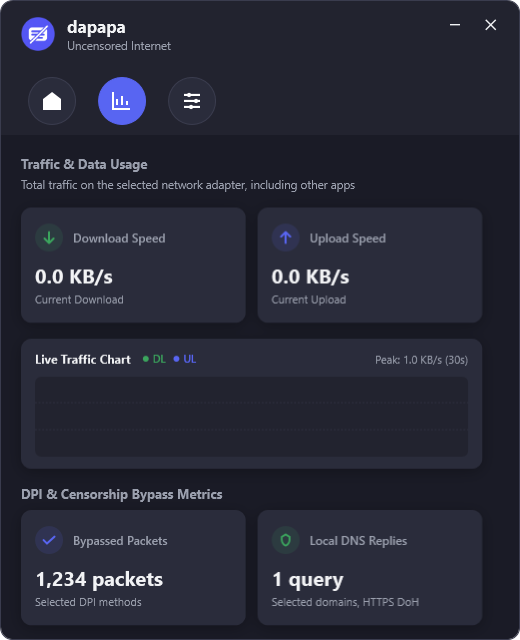
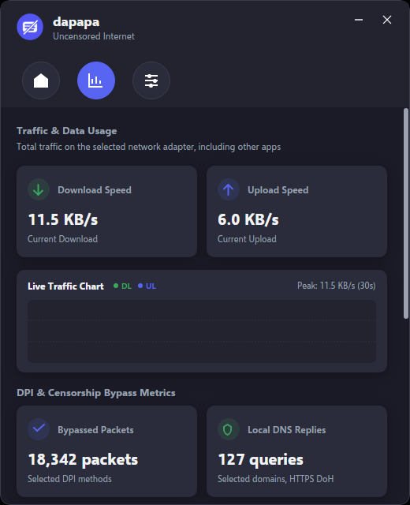
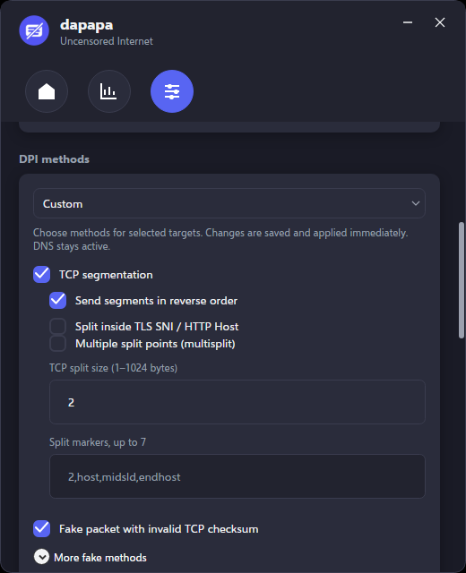
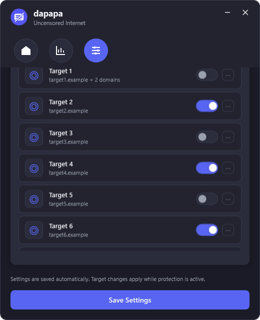
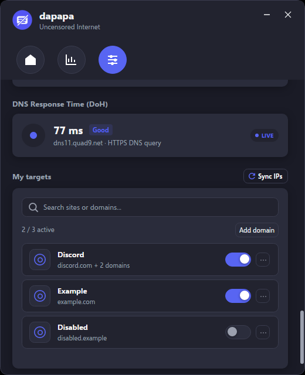

# Visual parity

The Avalonia GUI is a one-to-one port of the WPF window: same layout, element names, sizes, colours, animations and texts. Screens are rendered headlessly with Skia by `tests/Dapapa.App.Tests` (the same renderer Wayland uses) and compared with the Windows captures in this folder.

| Windows | Linux |
| --- | --- |
|  |  |
|  |  |
|  |  |

The Windows captures render the page content without its scroll bar column; the running Windows app shows the same 8 px bar as Linux.

## What is matched

| Item | Value |
| --- | --- |
| Window | 520×640, minimum 460×560, 12 px rounded frame, own title bar with minimise/close, drag and double-click maximise, 6 px resize edges |
| Palette | `#1A1B26` background, `#22232F` panel, `#2A2C3B` card, `#5865F2` accent, `#ED4245` danger, `#3BA55D` success, `#F2F3F5`/`#9BA0AE` text, `#3A3C4E` border |
| Font | Selawik, Microsoft's open-source font with Segoe UI's metrics. Line height is set to Segoe UI's Windows metric (1.33 × size) because Avalonia would otherwise use the font's tighter line gap. |
| Tabs | 48 px round icons in 70 px slots, accent fill when selected, 0.9 → 1 bounce |
| Status card | colour transition, glow, idle (1.4 s) and busy (0.45 s) pulses |
| Buttons | accent/danger/ghost styles, 1.035 hover and 0.965 press scale, glow on hover |
| Inputs | animated check boxes, 44×24 switches, 50 px text fields (the Windows template applied its padding twice), combo boxes, light round expander toggles, thin 8 px scroll bars |
| Cards | 10 px radius with soft shadow; target cards slide 3.5 px on hover |
| Dialogs | add/edit domain group, related domains, sync result, and confirmations/errors in the same card style |
| Text | every string from the shared TR/EN table; switching language updates open dialogs and the tray menu |

## Deliberate differences

| Windows | Linux | Reason |
| --- | --- | --- |
| System message boxes | Styled confirmation and error dialogs | Avalonia has no native message box; these match the rest of the app. |
| Related-domains dialog with a Windows title bar | Same dialog with the app's own frame and close button | Hyprland draws no title bars. |
| "Launch on Windows startup" | "Start on login" (XDG autostart entry) | Platform equivalent. |
| Balloon notifications from the tray | Desktop notifications (`org.freedesktop.Notifications`) | Same moments and texts: connecting, disconnecting, DNS provider change, "Done", and closing to the tray. One bubble is updated instead of stacking; without a notification server nothing is shown. |
| `✕ ⋯ ◎` text glyphs | Vector paths | The glyphs came from Windows fallback fonts. |

## Hyprland notes

The window runs through XWayland with WM class `dapapa` (native Wayland with `DAPAPA_WAYLAND=1`, app id `dapapa`) and draws its own frame, so no server-side decorations are requested. Hyprland tiles new windows by default; to keep the fixed-size layout, float the `dapapa` class and centre it (the README has the rule; in a Lua `hyprland.lua`, `center = true` had no effect in Hyprland 0.56, so the rule moves the window to the middle of the monitor). The tray icon is a StatusNotifierItem and appears in a panel with a tray module, such as Waybar's.
